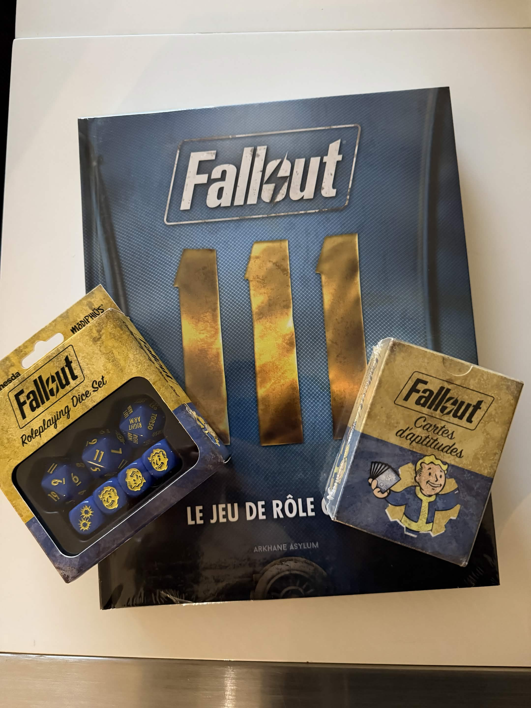
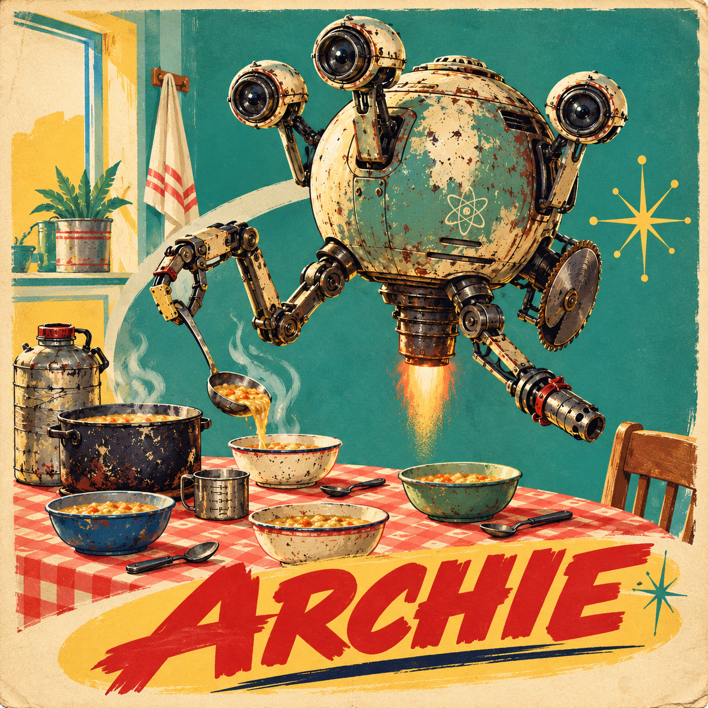
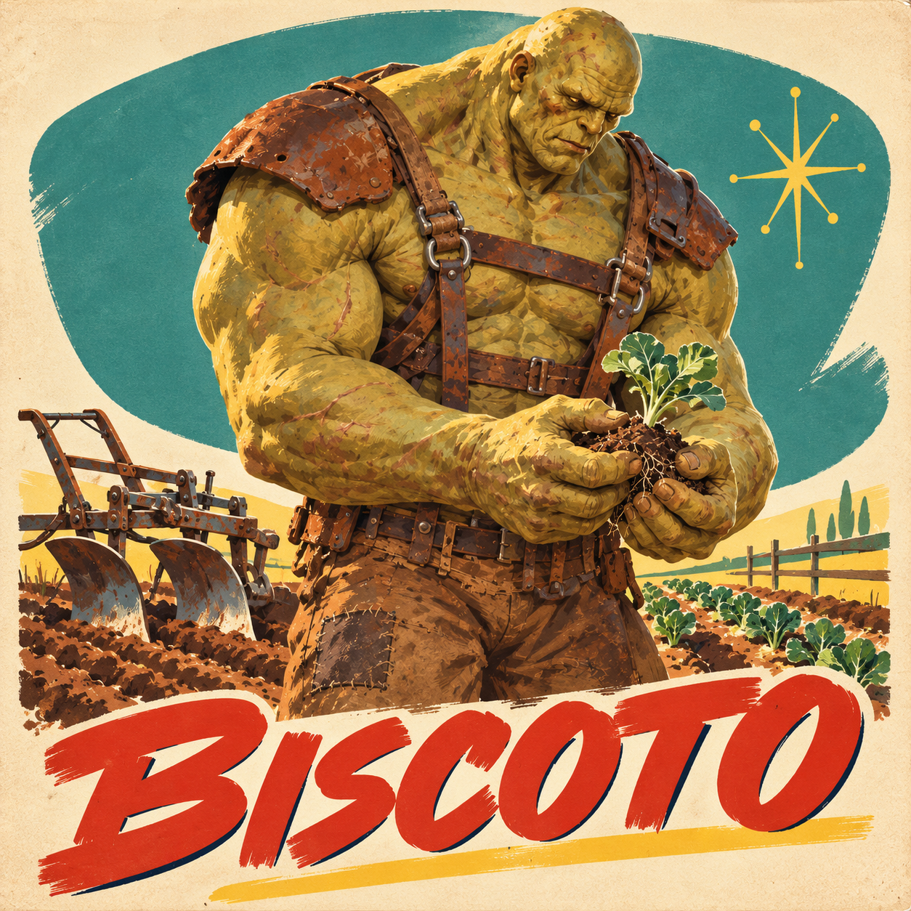
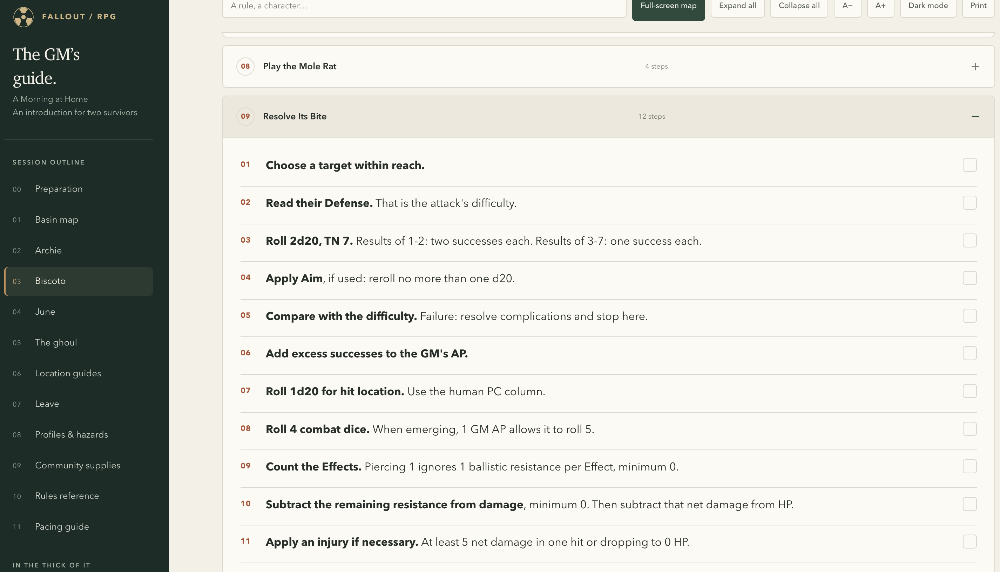
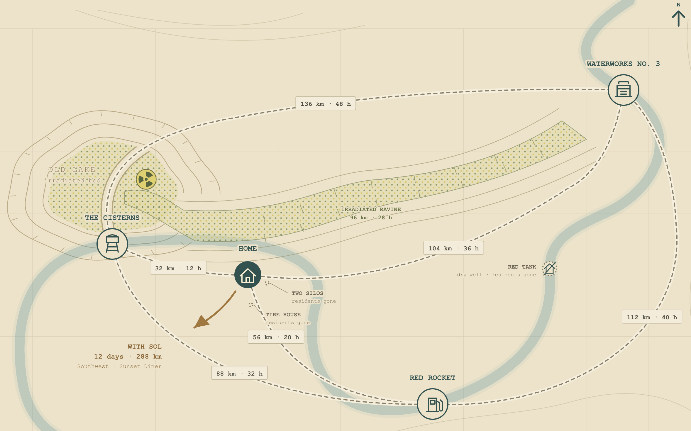

Last weekend, I walked into a tabletop game store. Those visits still take me straight back to my teenage years, when buying a game meant going to a shop and seeing what was on the shelves. Among the trading card games and board games was a small bookcase with four shelves of RPG books. I crawled over for a look, and three titles caught my eye: Blade Runner, Delta Green, and Fallout.

Fallout won. I paid €47 for the French core book and also picked up the custom dice set and perk cards as collectibles. After reading it and running an introduction for two friends, I have quite different feelings about the evening and the purchase. We had fun, and both players want to continue. The book left me disappointed.

## Why Fallout?

Fallout is a classic. To me, it's the D&D of the post-apocalypse. I played Fallout 1 and 2, the old isometric PC RPGs, and years ago I even made a character sheet for a fan-made tabletop adaptation. Jason Mical's Fallout Pen & Paper RPG was my reference. I came to this book with some affection for the franchise and some expectations of what it could feel like around a table.

What makes Fallout special for me is its tone. The world has been wrecked by nuclear war, yet it's sarcastic and weirdly funny. That offbeat spirit reminds me of the LucasArts era, especially Full Throttle. It's openly goofy in a very dark world. I wanted to find out whether this version could bring that feeling to two players who had never played the video games.

## A first session over breakfast

My aim was to let the players and the GM discover the main mechanics through play, then decide whether we wanted to continue. A player being able to explain why a combat system doesn't suit them is a useful outcome too. I planned about four hours in a small rural community called Home, where the two characters have grown up. Its well is dry, and the household has about eight days of water left. The session is about preparing an expedition to find more.

Breakfast with Archie, a rusty Mr. Handy, introduces inventory, recipes, hunger, and thirst. Noodles save drinking water; a mirelurk omelet can provide Action Points. Archie has all the polite protocols and absolutely no sense of how to read a situation. Depending on what he's trying to help with, his enthusiasm can be funny or downright psychopathic.

Then there is Biscoto, Home's super mutant farmer. This huge pile of muscle is afraid of violence, so the mole rats eating his vegetables become the players' problem. There's a sledgehammer nearby for a little whack-a-mole, along with options to trap the animals or drive them away. The vegetables they save go onto the same inventory they started at breakfast.

 

June's workshop and a visit from Sol, a ghoul trader, bring in crafting, equipment modifications, and barter. We played the kitchen and the fight from the prepared script; I adapted and improvised June and Sol's scenes using the same mechanics. The whole introduction took a little over four hours. Both players picked up on the goofy innocence amid the darkness, and both seemed keen to leave Home on that expedition.

## How 2d20 felt at the table

### The basic roll was easy to adopt

This was my first time playing Modiphius's [2d20 system](https://modiphius.net/blogs/news/2d20-basics), a shared engine adapted for Fallout. I found the core resolution straightforward and fast enough to keep the session moving. Combining an attribute and a skill is easy to understand, and I like being able to choose a pairing that fits the situation. For someone trying to oversell a gun, for instance, I'd propose Charisma + Small Guns.

The Combat Dice were functional enough for me too. They give you damage and effects to resolve from the same roll. Getting the whole attack procedure ready took more work, especially while learning Fallout, but the basic dice mechanics were easy to explain to newcomers.

The hit-location roll felt a bit weird. I understand why it's there: armor protects specific body parts, and critical hits can cause interesting additional effects. Still, that extra d20 roll felt like it slowed down the combat sequence a little too much.

I tend to prefer systems built around a particular setting. Qin's black and white Yin-Yang dice are the sort of thing I mean: even the dice express something about the world. I've written about that preference in the [S.I.X. article](/blog/six-building-two-table-ttrpg-from-scratch/). Fallout's S.P.E.C.I.A.L. attributes are immediately familiar to me, but the core roll didn't give me that same connection. Fast resolution is useful, yet plenty of systems can offer it.

### Action Points won me over

I wasn't sure what to think of Action Points when I read the rules. After playing, they're the part of the system I like most. Successes beyond what a test needs can generate AP, which the players can spend on extra dice and other benefits. They share a pool capped at six. That limit encouraged players to keep spending them.

The players quickly started spending AP to add dice to rolls their characters were already good at, hoping to generate more AP. Spending to rebuild the pool was an appealing little calculation. It gave us a reason to think about how much to invest in a roll, including one that already looked comfortable. The return depended on the dice, of course, but we were already looking for those opportunities during our first session.

The shared pool also changes the relationship between characters' actions: one player's successes can help pay for another player's roll. The name recalls the individual action budgets in the old Fallout games, while this version brings a cooperative resource to the table. We had no disagreements over who spent it. Whether that stays true when someone wants to burn the group's AP for a personal objective is something I have yet to see.

### Character building left me cold

Origin, attributes, skills, perks: I find this a very blunt way of putting a character together. Each level adds a hit point, a skill rank, and a perk. You can also spend that perk choice on improving a S.P.E.C.I.A.L. attribute. Progression keeps adding to the same parts, and I don't find much depth in those choices. The perk system feels simple and dated to me, however familiar it is from the video games.

One decision we did make was to open the full perk list during character creation. We could have shown players only the perks their current S.P.E.C.I.A.L. scores allowed, but I wanted them to see what they might build toward. I'm happy to replay a video game with another character to discover other options. For a tabletop campaign, I'd rather have that information available while making the character I intend to keep playing.

## Where the book made me work

### Crafting sent me hunting for information

The core rules are explained decently enough. Inventory, crafting, and mods are much harder to use. To prepare a particular modification, I wanted its caps value, recipe, components, and final stats together. Those details are scattered through the book, even though I need them together at the table. Gathering them into a usable reference is preparation work I expected the publisher to save me.

For the first fight, I also wanted the mole rat's attack in the order I would run it: target number, hit location, four Combat Dice for the bite, then its piercing effect against armor. I made a scene guide with those steps and the book's page references. Having the values in one place was a huge relief while running the session. A simple core roll still leaves several rules to coordinate when something bites a player.

### Survival needs somewhere to write things down

Food and water matter in the introduction because the players are preparing to travel. A meal can change what they need to carry, and whatever they take comes out of the household's stock. I wanted those decisions available without forcing every player to enjoy counting portions.

Yet the core-book character sheet we used has no dedicated tracks for Fatigue, hunger, thirst, or sleep. These systems are prominent enough that I expected somewhere to record their states. As soon as you use them, you need additional tracking space. Even good RPGs usually have bad character sheets, but this is an odd omission in a game with so much survival management.

### I missed Fallout's voice

The writing was the bigger disappointment. On page 127 of the French edition, the casual hat's descriptive text explains that a brim or visor shields the wearer's eyes from the sun. I already know what a hat does. I wanted a bit of Fallout's humor or a detail about life in the wasteland.

The faction summaries were just as dry. At times, reading them felt like browsing company profiles on LinkedIn. I could recognize the factions, but the summaries gave me little sense of how I might bring them into a scene. My memory of Jason Mical's fan-made version is of something funnier and closer to the tone I love.

Fallout already supplies the world, factions, and equipment, and this adaptation uses an established rules engine. That leaves me expecting a lot from the editorial work: clear organization, writing with Fallout's personality, and material that helps me turn the setting into scenes. That's where I wanted to see the effort, and where the book disappointed me.

The tone did reach our table through Archie, Biscoto, and the little community we built. I enjoyed bringing them to life. I also wanted the book I'd bought to do more of that work for me.

## The preparation behind the session

The four hours I spent on preparation exclude the time I spent reading the book. I used AI to assemble a scene-specific GM guide with rules and equipment references, calculate the household's starting supplies, generate the 1950s-style illustrations, and help code a route planner. For the inventory, the calculation was how much water and food four people would need for eight days with the chosen recipes. Archie makes five residents, but he doesn't eat or drink. Those were starting quantities prepared before the game; I ran the session myself using the guide.

The map gives the expedition three possible destinations: a finite stock of water, useful equipment, or a chance to restore a lasting supply. The route planner helped me check the stock against travel and delivery times. It may never be used at the table, but the map and destinations give us somewhere to go next.

> [!tip] My Fallout GM script
>
> I'm sharing the full [GM script for the introduction](https://fallout.ludicrpg.com/introduction/), with rules organized by scene, page references, and the inventory. Scenario-specific plans and assumptions are identified separately. The narrative side is rough; I adapted it while running the game.

## Would I recommend the book?

We'll probably play a short campaign, though I don't expect this to become the game of our year. I'm keen to see where the expedition goes; I'm much less enthusiastic about recommending the book that got us there.

The overall score below reflects whether I'd recommend buying this French core book at €47. The usefulness and inspiration I get from its contents carry much more weight for me than the binding or print quality. The aspect scores describe those separate qualities.

> [!review] Fallout
>
> **Overall: 2/5**
>
> At €47, I'd recommend this book mainly to someone who already loves Fallout and wants to run it with 2d20. The accessible core rules and shared Action Points made for an enjoyable introduction. As a GM, I still had too much information to assemble and too little inspiration from the reading. It gave me a badly presented spreadsheet in very nice packaging.
>
> ### Physical quality: 4/5
>
> The book is sturdy, the hardcover feels good, and the printing is clean. The illustrations are good too, though none astonished me. As a physical object, I'm happy with it.
>
> ### Content: 2/5
>
> The core rules are explained reasonably well. The scattered crafting and modification data make preparation harder than it needs to be, and the lore reads like a dull catalogue. I wanted more of Fallout's voice and more material that made me want to run a scene.
>
> ### System: 3/5
>
> The basic tests were easy to adopt, and the AP pool gave us decisions I enjoyed making. Character building and progression remain too shallow for my taste. The system works, but it gives me little reason to choose it beyond the setting I already love.
