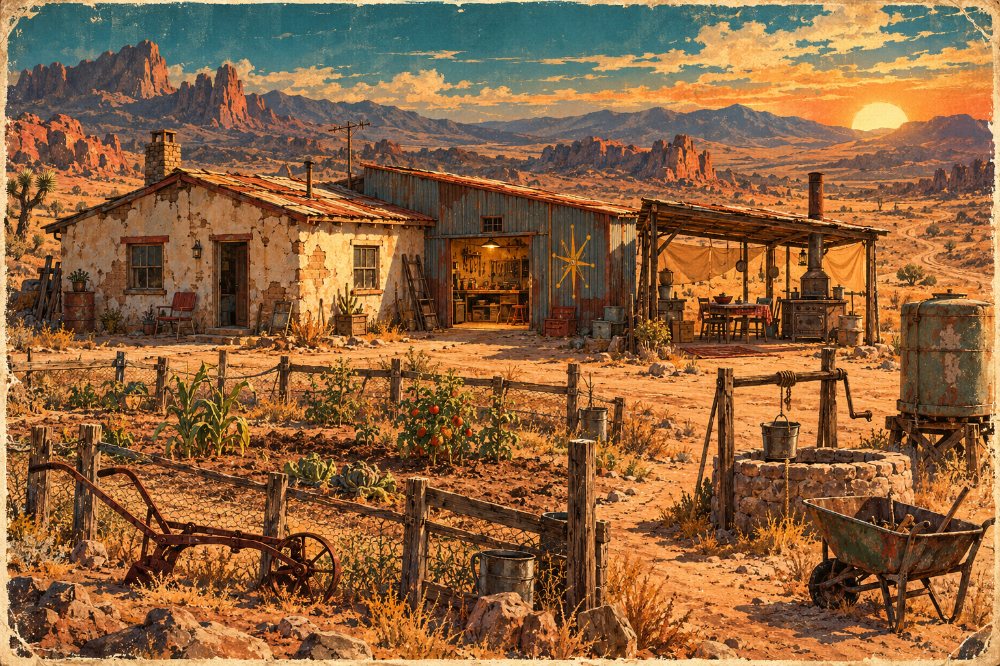
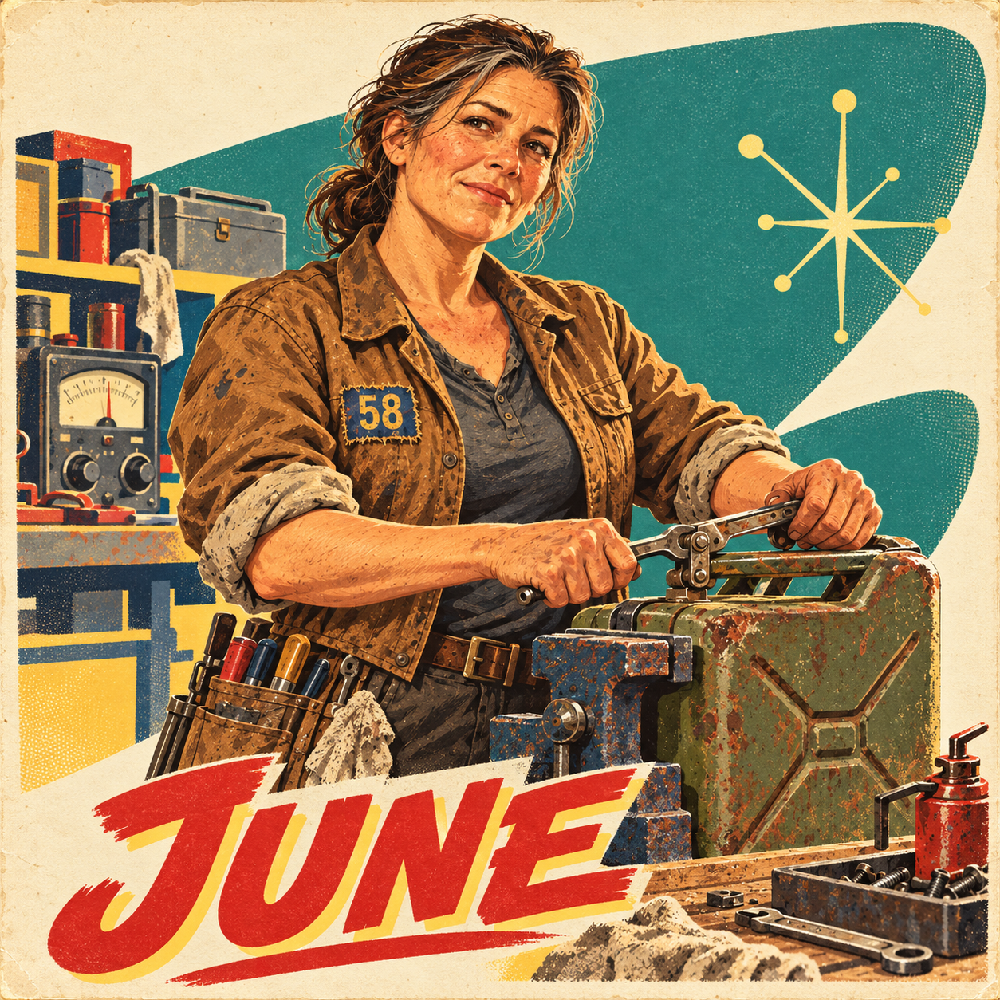
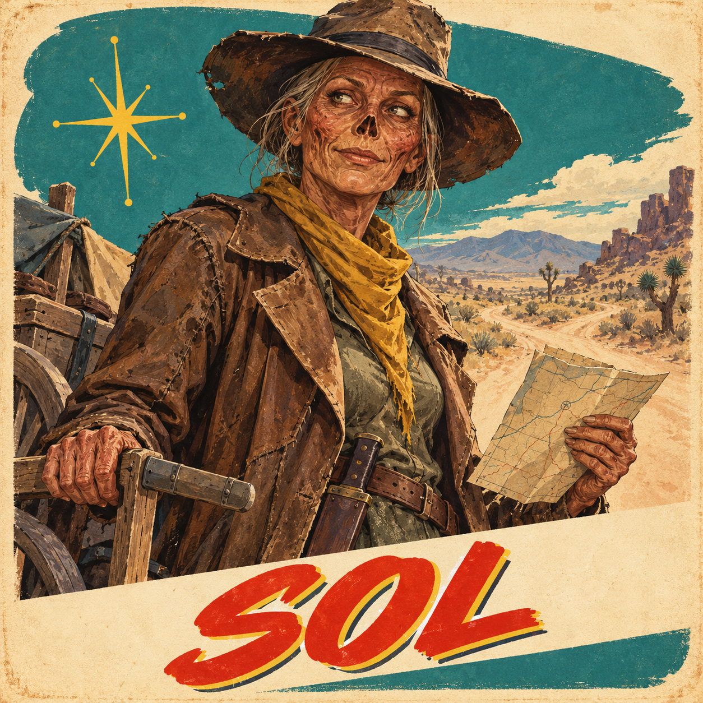
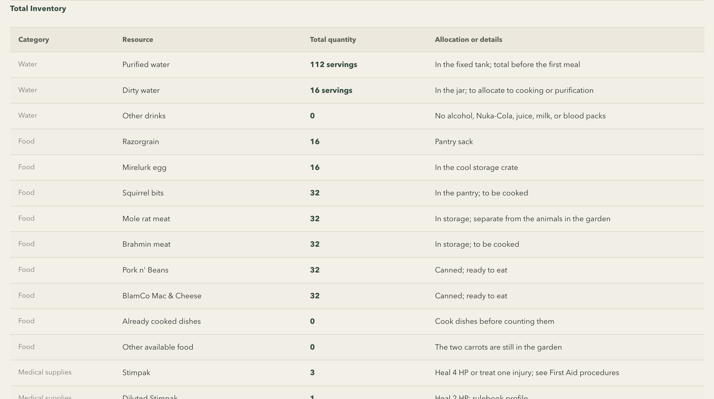
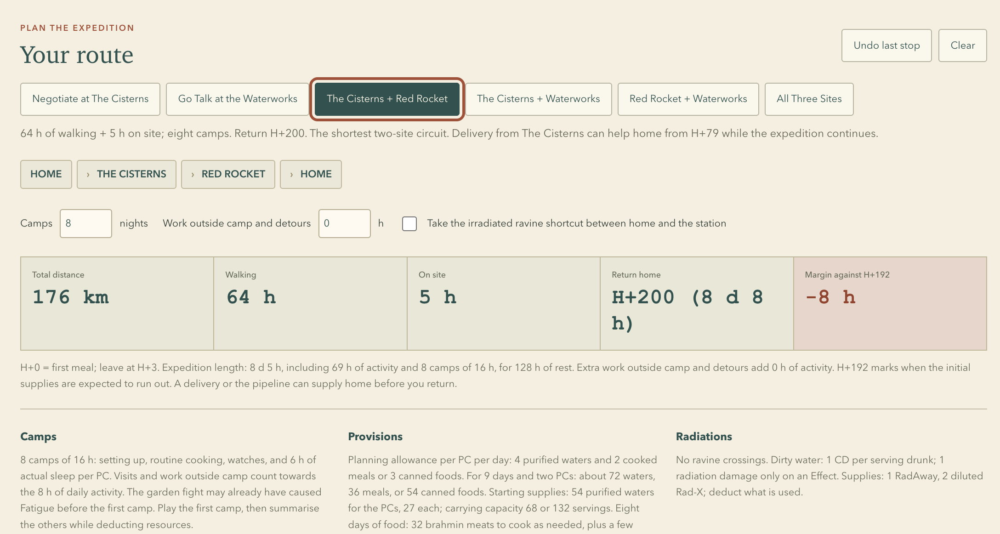

Last weekend, I walked into a tabletop game store. Those visits still take me straight back to my teenage years, when buying a game meant going to a shop and seeing what was on the shelves. The shopping was part of the experience.

Among the trading card games and board games was a small bookcase with four shelves of RPG books. I crawled over for a look, and three titles caught my eye: Blade Runner, Delta Green, and Fallout.

## Why Fallout?

Fallout is a classic. To me, it's the D&D of the post-apocalypse. I played Fallout 1 and 2, the old isometric PC RPGs, and years ago I even made a character sheet for a fan-made tabletop adaptation. Those games had an old-school approach: action points, levels, perks, inventory management, and character building without classes. I had enough history with Fallout to want to try this version.

What makes Fallout special for me is its tone. The world has been wrecked by nuclear war, yet it's sarcastic and weirdly funny. That offbeat spirit reminds me of the LucasArts era, especially Full Throttle. It's openly goofy in a very dark world. I wanted to bring that to the table while discovering how this version played.

## What I found in the book

I'm reviewing the latest French edition of the core book. I paid €47 for it in a shop and also picked up the custom dice set and perk cards as collectibles.

### The 2d20 system

I like dedicated systems, where the rules help give a game its own feel. I've written about that in the [S.I.X. article](/blog/six-building-two-table-ttrpg-from-scratch/). Trying another RPG is also a chance to discover another way to play, and Fallout gave me a reason to try Modiphius Entertainment's [2d20 system](https://modiphius.net/blogs/news/2d20-basics), which the publisher describes as a cinematic ruleset. I hadn't played it before.

The core resolution is straightforward, combining an attribute and a skill. I like the flexibility of choosing a combination that fits the situation. For someone trying to oversell a gun, for instance, I'd propose Charisma + Small Guns.

Combat is simple and classic. Damage uses custom six-sided Combat Dice, and initiative is a fixed score based on your character's stats. Whoever starts the fight takes a turn before the first round begins.

The table also shares a pool of up to six Action Points, used to roll more dice, increase damage, take additional actions, or act faster.

## The goals of session zero

I wanted to see how the game felt in play. For me, a good session zero should expose the players and the GM to all the mechanics. We need to understand how they work together and what opportunities they give us in the sandbox. I also want the players to feel what makes Fallout distinctive and to leave with a story they're curious to follow.

If a player can explain why the combat system doesn't suit them, that's a big win. So is being able to say, "I want to continue," or "I don't think this game is for me." That's the outcome I'm after: a complete overview that lets everyone form their own opinion and decide whether they want to keep playing.

I was aiming for about four hours of play, starting in a small rural community called Home, in the middle of nowhere. The two player characters live there with June, Archie, and Biscoto. Its isolation keeps the worst of the wasteland at a distance, so survival still feels relatively gentle.

This session kicks off an expedition. Home's well is dry, and the players need to decide what to do about it.

### Archibald's kitchen

The day starts with Archibald, or Archie, an aging, rusty Mr. Handy robot. He has all the polite protocols and absolutely no sense of how to read a situation. His enthusiasm can be funny or downright psychopathic, depending on what he's trying to help with.

I wanted breakfast to introduce inventory, recipes and blueprints, hunger, thirst, and food systems. Choosing what to cook lets the players see those rules working together: noodles save drinking water, while a mirelurk omelet can provide Action Points.

### Whack-a-mole with Biscoto

Biscoto is a super mutant and Home's farmer. The twist is that this huge pile of muscle can't fight anymore. He's afraid of violence for some forgotten reason. He's the one who introduces the combat system.

Some mole rats are eating the vegetables. There's a sledgehammer nearby, which gives us the possibility of a little whack-a-mole and a first encounter with the combat system. I also prepared ways to trap the animals or drive them away. The reward is tied to dealing with the threat to the crops, so the players can earn it through those solutions too. The vegetables they save go onto the same household inventory they started at breakfast.

### June's workshop & Sol's trade

June is Home's leader, an engineer who escaped from a Vault. Her workshop introduces crafting and modding, while visits from Sol, a friendly ghoul trader, introduce trading and barter.

### A reason to leave Home

To help them plan the expedition, I made a map with local lore, distances, and travel times, introduced through a conversation with June and Sol. The destinations offer different possibilities: a finite stock of water, useful equipment, or a chance to restore a lasting supply. They can decide what seems worth the journey.

## The GM needs an introduction too

Preparing this introduction and its supporting material took me four hours, excluding time spent reading the book. I started by listing all the mechanics with AI and grouping them by scene. I also generated illustrations with a 1950s advertising aesthetic.

A straightforward core roll still leaves a lot to remember when a creature attacks: its stats, the sequence of actions, where damage lands, and what the effects do. I wanted to be able to run that first fight without flipping through the book every time I reached another step.

With AI helping me collect the relevant information from the book, I put together a guide organized by scene. It covers cooking, installing modules, and combat, with the rules and exact values in the order I need them. For the mole rat's bite, the guide gives me the target number, the hit-location step, and the four Combat Dice to roll for damage, followed by how its piercing effect interacts with armor.

Having the exact data, at the right time, in one place was a huge relief while running the session. The guide keeps the book's page references alongside the rules and identifies the plans and assumptions specific to this scenario.

### Bookkeeping is boring, but inventory matters in survival games

You can skip the bookkeeping and introduce shortages narratively to drive the story. I wanted the players to feel that scarcity themselves, without forcing them to track every portion if they don't enjoy it.

I used AI to help calculate an inventory against the household's needs and the travel times. There are five residents, but Archie doesn't eat or drink, so the food and water have to cover four. Under the starting assumptions, the water budget gives them about eight days, and the players' choices during the introduction can change that. Getting the quantities, hunger and thirst rules, and possible journeys to fit together involved a lot of initial bookkeeping. AI did the heavy lifting on those calculations.

I also vibe-coded a little route planner with a quick prompt. It's probably over the top, and it may never be used at the table. But it helped me check whether the stock, travel times, and possible deliveries made sense together. If the players want to plan closely, I have something to work from.

> [!tip] My Fallout GM script
>
> I'm sharing my full [GM script for the introduction](https://fallout.ludicrpg.com/introduction/). It's mostly rules organized by scene. The narrative side isn't polished, since I built my own story around it.
>
> At the table, we played two of the script's four scenes (the kitchen and the fight), and I adapted and improvised the scenes with June and Sol using the same mechanics.

## Feedback after the session

The introduction took us a bit more than four hours. For me, it was fun, interesting, and did exactly what I'd hoped: the players and I got a full overview of what the game has to offer. The Fallout setting seems to have come through, too. Neither player had played any of the video games, but both picked up on that goofy innocence amid all the darkness.

Overall, my first impression is that the system is functional and cinematic enough to keep things moving. I don't find a Fallout identity in the rules themselves, though. They use Fallout's signature S.P.E.C.I.A.L. attributes without feeling particularly special.

The Action Point system gives it some flavor. The original video games used action points in turn-based play. Honestly, I didn't know what to think when I read the rules, but I like the system after playing it. It gives players a bit more agency over their actions, with a small choice that tunes their rolls and actions. It's good.

I think we all agreed that character building is kind of shallow overall. I also find progression through perks dated and too simple. That's how it works in the original video games too, so I can't blame the tabletop RPG for that.

Both players seem keen to continue with the expedition, which is another good sign. But it definitely won't be "the game" of our year. We'll probably play a short campaign, then move on to something else.

> [!review] Fallout
>
> **Overall: 2/5**
>
> To me, this book feels like a bit of franchise abuse: a nice physical book, but a poor read. As a GM, I'd have to bring much of the life and depth for a long campaign myself. I still love Fallout, but this book didn't give me an "experience" as a GM. It gave me a badly presented spreadsheet in very nice packaging.
>
> I wouldn't recommend this game at this price unless you're a franchise fan or looking specifically for a light, beginner-friendly TTRPG in a post-apocalyptic setting.
>
> ### Physical quality: 4/5
>
> The book itself is sturdy, the hardcover feels good, and the printing is clean. The illustrations are good too, though none astonished me. As a physical object, I'm happy with it.
>
> ### Content: 2/5
>
> The core rules are explained decently enough. The inventory, crafting, and mods are a huge mess. Data is everywhere and nowhere. A simple giant table would be so much better than this scattered information. Trying to piece it together is a nightmare.
>
> The lore is lazily written. After decades of Fallout games, what the book gives the GM is a functional catalogue of factions and other elements from the video games. Nothing feels alive. The sarcastic, offbeat tone that made me want to play Fallout doesn't come through. If this book were my introduction to the setting, I don't think I would understand what makes its tone so distinctive.
>
> ### System: 3/5
>
> 2d20 is smooth and straightforward. Action Points work very well on top of it and bring some Fallout flavor. It's fun, but the system doesn't bring much identity of its own.
>
> Character perks are okay. Crafting and modding are a big part of the system, and progression is simple. Most of that comes from the video games. Nothing special.
