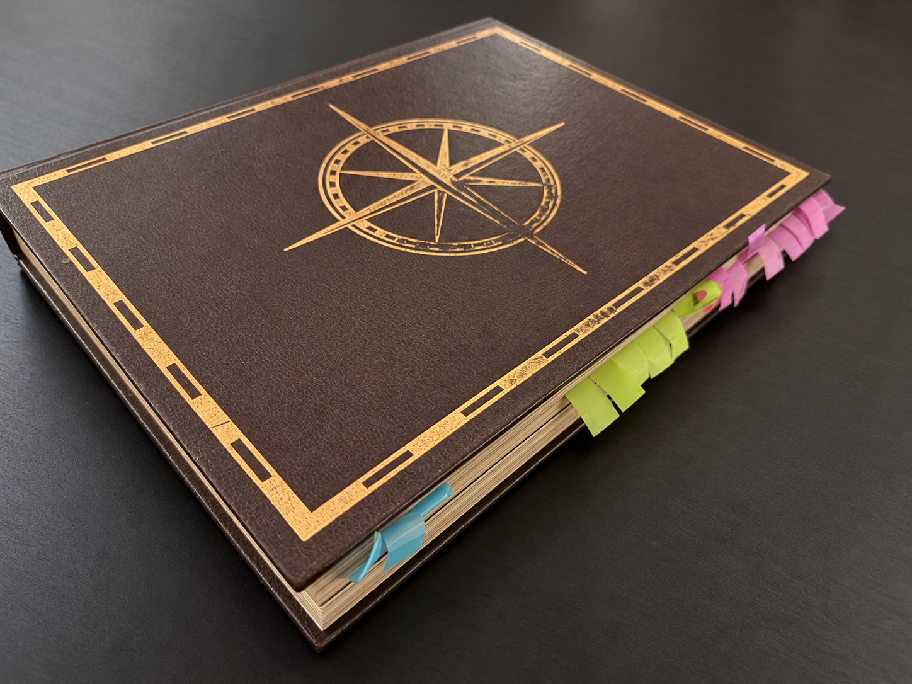
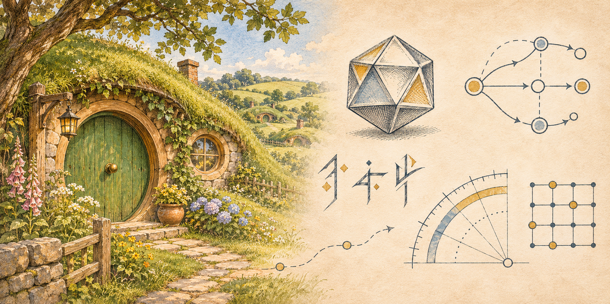
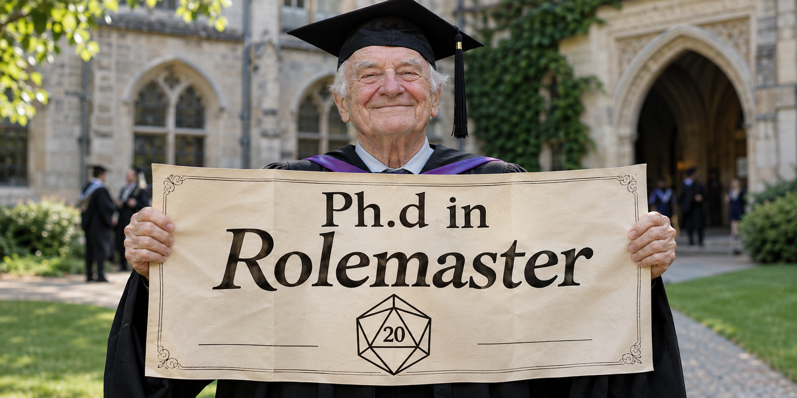

*No quarter for the rules! Or the GM ?*

I've been drawn to Greek and Chinese antiquity, the Renaissance and the Wild West. Exploration, discovery, whole societies changing: I'm fascinated by how people lived through all that.

Years ago, a friend ran a session of the first edition of *Pavillon Noir* (Black Flag), a French historical RPG about pirates, privateers and life at sea. I was drawn to its Age of Sail setting: new hopes and new wrath, with possibilities that seemed endless. I bought the second edition and later ran a campaign. I love these books. The paper, the stories, the historical detail are truly inspiring. Then I try to run it and struggle not to drown in all that depth.

This game is heavy on rules, and reading them all and making sense of them is work. But running a whole session while juggling all these systems is a massive challenge. So after that campaign, I decided to commit even more and bring my Ludic take to it.

## One scene, three books

*Pavillon Noir* is a different kind of TTRPG beast. Characters influence the crew, which in turn affects the ship and how it responds to its environment. That connects several gameplay loops and rule systems:

- **Characters:** individual skills, actions and combat, with further depth in advanced fencing.
- **Crew:** command roles held by player characters or NPCs, group actions, crew experience, temporary groups and organised divisions (*bordées*), losses and wounded sailors.
- **Ship management:** cargo, supplies, logistics and the ship's condition.
- **Sailing:** wind, the ship's direction relative to it, and sea conditions.

The way the rules fit together is clunky. For one scene, I have to hunt down the relevant passages and work out how several systems and subsystems interact. A few reminders fit on the GM's screen; the rest depends on what I remember and can find across the books. I think we're asking a static book to do too much here. This is my second-edition rulebook:

*Each colour links the scattered passages I need for one rules topic. I had already removed many tabs in other colours because even the markers had become unmanageable.*

A tabletop wargame can have extensive rules and exceptions, but play usually stays within the same scale and scope. In this TTRPG, one sentence from a player can change both. Imagine this:

> During a boarding action, someone fires a poisoned dart from a blowpipe at an enemy on deck. I resolve the attack, damage and wounds, then apply the rules for that poison and track its effects.
>
> If the poison leaves someone in a command role unable to command, I also need the rules for losing that officer and testing the crew's morale. If the ship is free to manoeuvre and the crew attempts it, the result can change the ship's position relative to the wind, with consequences for its movement.
>
> Finally, suppose that manoeuvre leaves the ship exposed to waves breaking over the deck. Another player tries to fire a soaked flintlock. I need the misfire rules and their table of modifiers for wet conditions.

Using curare for the dart, I mapped 32 groups of rules and reference tables across 30 pages in three books. That includes calculations prepared before play, such as wound and command values. And I haven't even resolved what the other crew group is doing.

Too many rules? Maybe. But I don't see it as a simulation. I strongly believe these interconnected systems try to express what is specific to this era and environment. The challenge is to put those possibilities in the players' hands, at a pace that lets them enjoy the discovery instead of feeling overwhelmed.

## I know very little about navigation

The second problem is that I don't sail myself. Nor did I live in the 1600s. I can find the rule and still have no idea what to describe. I'm already busy trying to make us feel aboard an unstable wooden vessel exposed to the sea. Take the book's -4 to +4 naval situation modifier: I can apply the number, but what does the advantage look like? The book offers advice and optional aids, but our characters might recognise an opportunity before we even know what to look for.

Simply ignoring the rules can make this harder. The book acknowledges that resolving group action through narration can demand considerable naval expertise and leave too much of the outcome in the GM's hands. I would be replacing them with my own romanticised narration, limited by what I know about life at sea. The depth here is great. To me, it makes all the difference between D&D with a "naval" tint and a unique experience of this era.

I see these rules as a sandbox worth exploring, and some of the maritime knowledge I'm missing is already in there.

## A galaxy far away can feel closer than our own history

Walking into a Star Wars cantina can feel easier than entering a seventeenth-century port. Even a fairly superficial knowledge gives us some idea how to behave around an Imperial officer, what a smuggler might want, or where a terrible bargain could lead. Films, games and stories have done that work before we sit down. Familiarity matters more here than whether the world is historical, fantasy or science fiction. Our characters have lived in this world for years. We have just arrived with dice.

I remember arriving in Tolkien's Lórien while playing an elf, incredibly excited to be there. The GM described the place, then our characters were free to roam. "What do you do?" And I had no idea what to answer. I wanted to do so much, but I couldn't turn that excitement into something I could actually say my character was doing.

Helping players find their feet in a new setting is part of the GM's work. I think expressive rules can contribute as much as narration, a carefully chosen playlist or acting. Maybe that's why I dislike generic systems. I want a system to be functional and fun, but also to express something about its setting. Dice, mechanics and the way we interact with the rules can all become ingredients for emergent play.

After a bit more than twenty years of GMing, I'm trying to help my players imagine concrete actions that make sense in the world their characters inhabit. I want them to spend more time pursuing their ideas and less time waiting for me to suggest what to do. Maybe that can make some TTRPGs more accessible too. The depth of *Pavillon Noir* is definitely a great challenge.

## Are we aboard the same ship?

### Knowing what we want to try

In Lórien, I had the desire to explore and permission to do it. I was missing something more specific: a plan I could act on. In [his 1999 essay on computer-game design](https://www.gamedeveloper.com/design/formal-abstract-design-tools), Doug Church calls this **intention**: forming a plan from our understanding of the situation and the actions available to us.

A cargo entry with a name and a price gives us something to sell. Knowing its uses and how it travels could give us other ideas. If all my work reaches the players as "some goods worth 200," most of its possibilities have stayed behind the screen.

Knowing who needs those goods lets us decide whom to approach, without waiting for the GM to list buyers. That is how I think about Don Norman's [**signifiers**](https://jnd.org/signifiers-not-affordances/): clues that help us notice possibilities. An **affordance** is an action someone's abilities and environment make possible, whether or not they notice it.

### Is it a world or just a backdrop?

*The Matrix Reloaded (2003). Film still via [StudioBinder](https://www.studiobinder.com/camera-shots/composition/symmetrical-balance-in-film/).*

If I describe the weather, the ship's position and the officer shouting orders, then resolve the attempt as though none of those details mattered, why would they keep paying attention? I've encouraged them to read the situation and then made that reading useless.

That relationship between what we want to do and what the game supports is part of **player agency**. [*Agency Reconsidered*](https://cs.uky.edu/~sgware/reading/papers/wardripfruin2009agency.pdf) explores it in digital games, including how players learn a game's workings through their actions. If every option has to come from me, I shouldn't be surprised when the players wait for me to tell them what to do.

I can prepare all I want, but during the session I'm relying on the players' contributions to give that world a life we can share. We keep adjusting our understanding as we go. [A philosophical account of shared imagination in D&D](https://link.springer.com/article/10.1007/s11097-025-10106-2) describes immersion as that ongoing social attunement to the world.

## Feeling at home enough to surprise each other

My ambition is more **emergent play**, but getting there in *Pavillon Noir* takes time. The crew finds connections between the ship, the wind, their resources and their own abilities, then comes up with a plan that surprises me. I get to discover what happens alongside them. That's already part of why I play TTRPGs. I want it to become more fluent and more often driven by the players as they get comfortable in this particular world.

The pleasure of being able to act and contribute to a shared world also connects with [research on video games](https://selfdeterminationtheory.org/SDT/documents/2006_RyanRigbyPrzybylski_MandE.pdf), which links enjoyment with competence, autonomy and relatedness.

## Discovering a rule differently

With [*Magic: The Gathering*](https://magic.wizards.com/en/how-to-play), my interaction with the rules is scoped, progressive and intuitive. I can read a card before a match and start imagining how I'd use it. Browsing the cards is already part of the fun. An interaction that makes me want to build a deck gives me a reason to learn that bit of the system. During play, the cards are right there to read, point to and pass around. The ones on the table matter now; my hand gives me options, and the deck holds what might come later.

*Deadlands*, the first Wild West RPG I encountered, caught my attention with dice and cards when d20s and d6s were kings, with d10s as their queen. I could bring my whole dice set into play. The shape of the dice tells me something about my character's strengths. Another genius idea: players could slide coloured paper clips around a coffin on the character sheet to track wounds to different body parts. That gives the wound rules an intuitive, physical form.

For *COPS*, the police RPG, I made cards to help combat feel more dynamic and dramatic. They put some bookkeeping on the table and give new players rule reminders during the fight, when they're deciding what to do.

With the [*Alien* motion tracker](/blog/building-the-alien-rpg-motion-tracker-immersion-without-friction/), a player sweeps a phone around looking for contacts, using the device their character is using. The search itself brings tension into the scene. It's diegetic and intuitive.

Technology fits *Alien*, *COPS* or *Cyberpunk* much more easily. For a pirate game, it's tricky. It could look like a big stain in the middle of the table. I have no clue yet how I'll solve that with my usual approach.

## Starting with the game we have

I was overwhelmed. I've spent several weeks building a working corpus from four books, keeping source references and recording gaps. I can now check whether a rule is missing, hiding in another chapter, or in conflict with another passage.

I may change parts of the system or eventually replace the whole thing. First, I want to run the original game fluently and understand what its procedures represent, how they make this world playable, and what they abstract away. I'll share the research and experiments, including what needs to go back to the drawing board after play.

For a first practical attempt, I started Le Comptoir, the commodity catalogue, so the GM or the players can easily explore what might be waiting in a ship's hold. Cargo connects something immediately appealing, stealing a ship's goods, with a world we know much less about. I focused on the goods themselves:

- Descriptions that give us something to reason from when a player invents a use I never thought to list.
- Illustrations that let us show or describe what something like ambergris looks like.

That's where the next article, [*The Trading Post: A World in the Hold*](/blog/the-trading-post-a-world-in-the-hold/), takes us. I'm working on what we'll find when we open that hold. What the crew decides to do with it is something I want to discover at the table.
