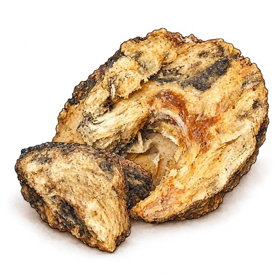
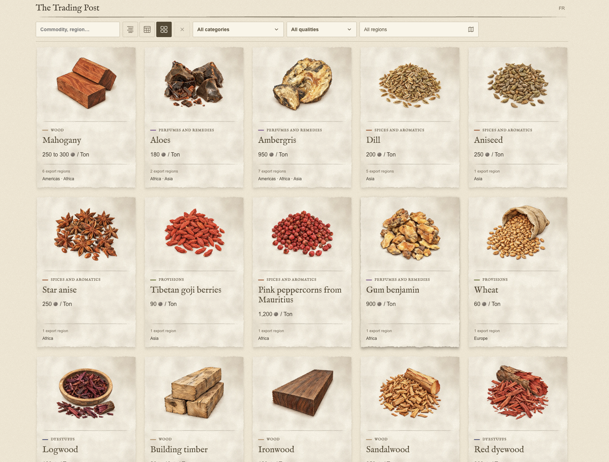
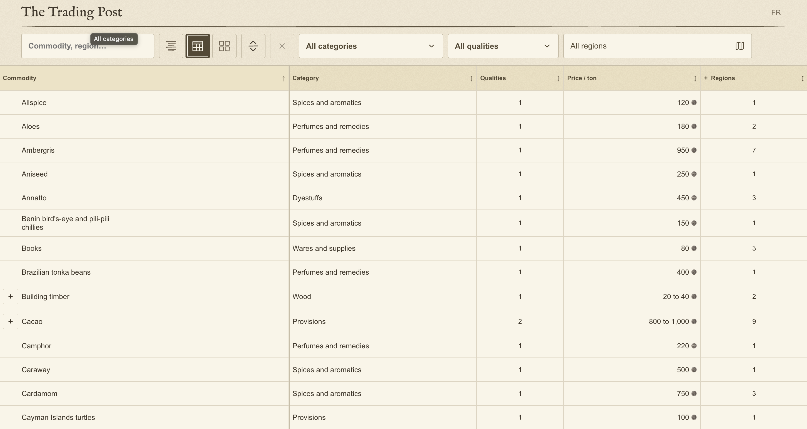
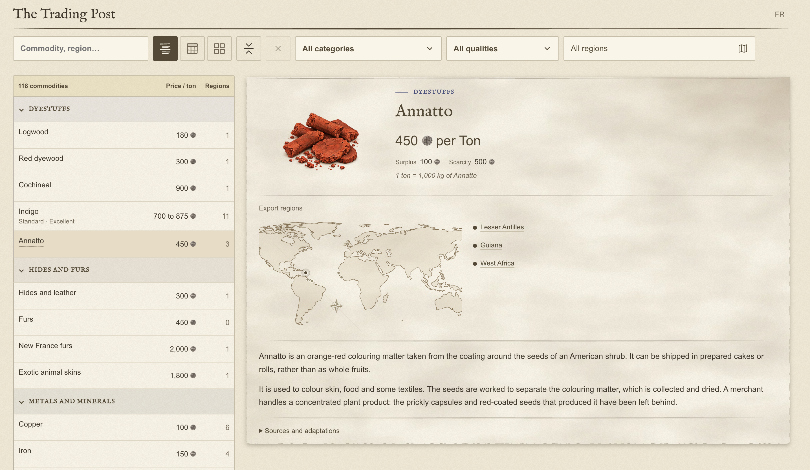
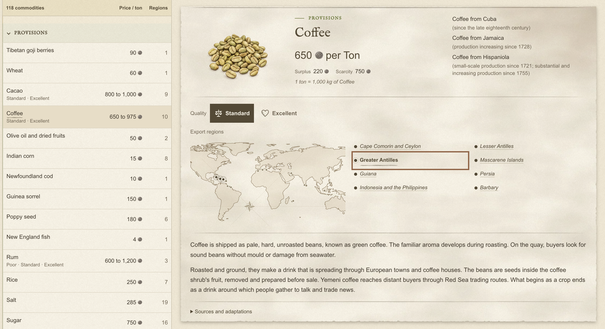
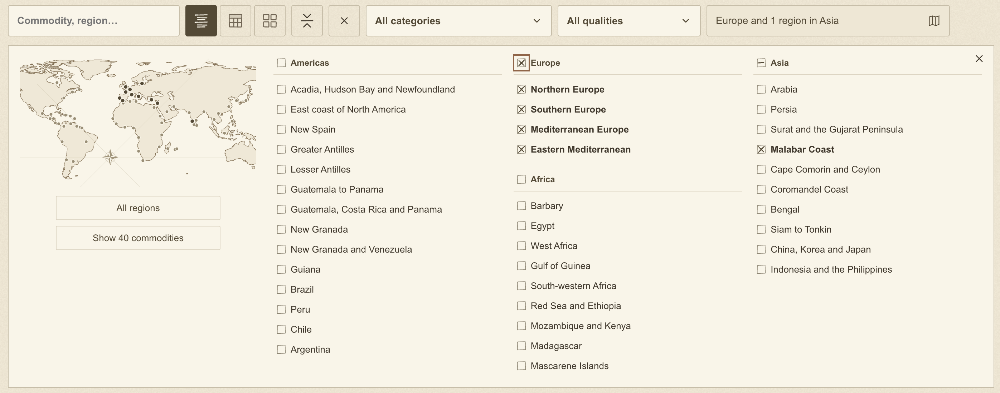
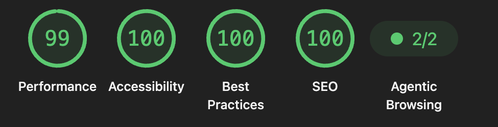
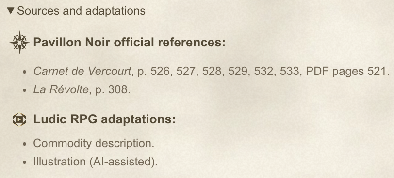

Sail, catch, plunder, sell, repeat. That's the game loop you'd expect from a pirate game. But why? The answer is in what filled those ships' holds. The Spanish Crown backed Columbus in his search for a new trade route to Asia. My players are after the cargo too. With Europeans crossing oceans for exotic goods and new resources, it seems a shame to just hand the crew a loot table with prices.
## A book written to inspire

I love the *Pavillon Noir* books because they're meant to be read, not browsed. Everything is a story, from the rules to the catalogue. Writing like this has a price: the books are harder to search, and the information ends up scattered everywhere.

In the core book, I came across a red dye called *rocou*, or annatto, in a character description:

> “His body is covered in red annatto” (*La Révolte*, p. 332, my translation).

The description? That's in the flora chapter of another book.

> “By rubbing the seeds in water and letting the water evaporate, you get little bright red cakes” (*Carnet de Vercourt*, p. 488, my translation).

You finally get the trade names in the cargo tables: *annatto*, *annatto from French Guiana* and *annatto from Upper Guinea*, all listed at the same price (pp. 525 and 527).

I can imagine what it costs to print that lot again as an index. I wish TTRPG publishers would give us quality books like these and a spreadsheet on the side. So... I fixed this.

## From data analyst to little botanist

It took me several hours to compile the **394 commercial entries** across those two books. I found a trade price for **333**. Now how was I going to organise it all?

I had to look at both quality and origin. At the normal price, fine wine fetches three times as much as coarse wine (*La Révolte*, p. 308). Indigo from Louisiana and indigo from Yucatán, on the other hand, have the same base price.

Take pepper: I counted 26 rows of it in Vercourt's cargo tables. Spanish pepper, black pepper from India, black pepper from Bali, Sichuan pepper... I had to work out which “peppers” were varieties of the same plant and which were entirely different spices. I became a little botanist for a night. Some of the names had changed over time, too. Looking them up was a maze.

In the end I had **118 commodities in 11 categories** for [the Trading Post](https://black-flag.ludicrpg.com/commodities). The cards cover **354 designations**, keeping the regional names, qualities and prices together.

## An inspiring spreadsheet?

Changing the format shouldn't mean losing the depth. I still wanted a GM looking at a spreadsheet to feel there was a world behind the stuff in the hold, just as I did reading the books.

What does it look like? Where does it come from? What is it used for? Sometimes I had a much simpler question: what is it? With goods like aloe, the name alone didn't tell me much.

I went back through all four books looking for descriptions. Of the 118 goods, **24** had a passage about the good itself or the material it came from. For **44** I had to pick up clues here and there (the officers get saffron in their meals, for instance). The other **50** were just names. Those I had to research from scratch.

Take [ambergris](https://web.prm.ox.ac.uk/bodyarts/index.php/temporary-body-arts/scent/37-ambergris-oceania.html). What the players pick up is a waxy lump, sometimes grey and marbled, with a strange musky smell. It forms inside a whale. Who might buy it off them? Somebody making perfume. I like that the table could follow one piece of cargo in either direction and find their next story.

Looking up goods as cargo sent me down another rabbit hole: how did they pack the stuff? Some things need to stay dry.

In the *Carnet de Vercourt*, porcelain travels in wooden crates padded with fragments of palm leaves. Higher up in the hold, silk and cotton fabrics brace other goods (p. 467). Those palm leaves are a tasty detail to have when the players open a crate.

I also wanted illustrations of the cargo as shipped. Art is super expensive in TTRPGs, and drawing all 118 commodities by hand was more than I could take on. So I gathered reference photos of the goods and used AI to illustrate them.

Translation got me too. *Pavillon Noir* never got an English edition (what a shame), and doing the catalogue in both languages gave me a new kind of trouble. Translate *piment de la Jamaïque* as “chilli” and everyone imagines hot pods. Open the sack and you get dried berries: [allspice](https://plantfinder.mobot.org/PlantFinderDetails.aspx?taxonid=282860). Even the name of an island could change depending on whether a French or an English sailor drew the map.

## An efficient display for the GM

I spent way too long on the presentation of this... simple database. I made three layouts.

### Commodity gallery view

The large illustrations are there to spark a GM's curiosity as they wander through the catalogue.

### Table layout

Half the time I'm on a website trying to sort or filter something, I'm thinking, “Just give me the god damn Excel.” Then I've got one more spreadsheet open next to all my GM stuff. The browser table is fast to search, filter and sort.

### Categorised view

This is probably the view I'll use most during a session. The list stays put beside the card. And there's my annatto, with the red cakes from the flora chapter and the price from the cargo tables both in front of me.

### Friendly filters

I fiddled with the type and the layout so I can find the coffee price first, then pick the Greater Antilles and get the names from Cuba, Jamaica and Hispaniola.

The region filter has an interactive map because it uses names from the 1700s. My geography is shaky enough with today's names. I'd rather skip that round of Trivial Pursuit mid-session.

 

### Technical details, semantics and performance

Pirates didn't have laptops, but a little paper texture and a colour palette seemed fair. I still want to be able to read a price, so no damaged manuscript lettering over burnt paper.

The Trading Post works on a laptop, tablet or phone, depending on what you've got at the table. The table view is really meant for a wider screen, though.

I [labelled the rows and columns](/blog/ludic-rpg-site-v1/#meaning-is-everything) so a GM using a screen reader can hear which number is the price per ton. And everything is shareable, if I drop the link to pepper in our group chat, my crew gets a picture of what they've just stolen.

I also wanted the page to load fast enough that opening it wouldn't interrupt a session.

I won't go deeper about the UI, UX, or tech works, but it was probably as much time as assembling the final data together.
### Credits and authorship

Open “Sources and adaptations” on any cargo card and you'll see the book and page, what I added and where I revised an existing description. Anyone can work with the data. The writing is the special touch of these books, and I'm not about to copy and paste it.

This is just the beginning, but the foundations are in place. The goods that drove trade in this era are the same ones my crew gets to plunder and sell.

You can open the catalogue in either language:
- 🇬🇧 [The Trading Post](https://black-flag.ludicrpg.com/commodities)
- 🇫🇷 [Le Comptoir](https://pavillon-noir.ludicrpg.com/marchandises)
