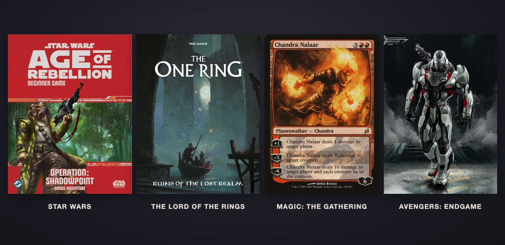
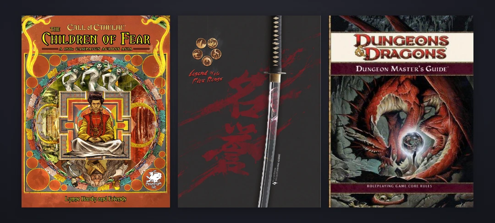
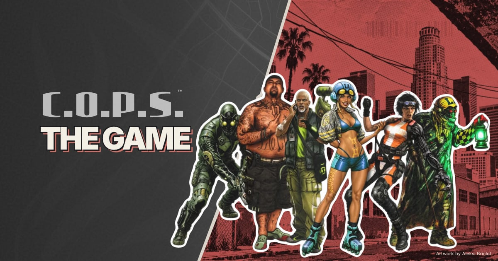
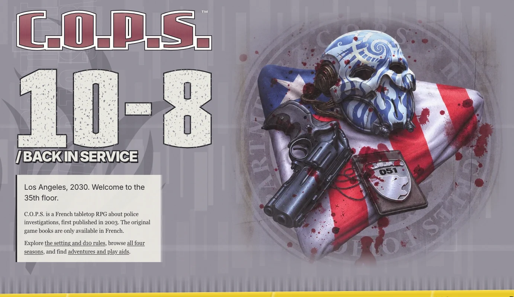
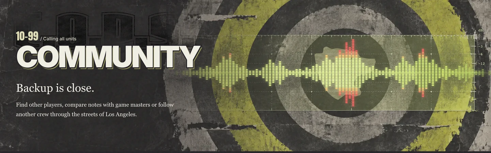
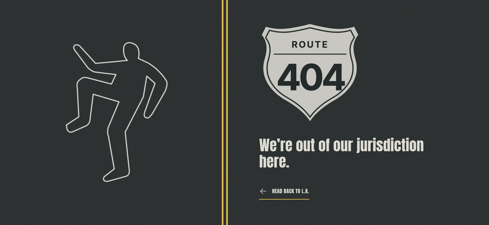

Do you know what a *Star Wars* adventure, a *Lord of the Rings* sourcebook, a *Magic: The Gathering* planeswalker and a time-travel suit from *Avengers: Endgame* have in common?

Two people link all four, and they worked together on **COPS**, a [French police TTRPG](https://cops.ludicrpg.com/en/the-game/) that left its mark on a generation of GMs. I've been running it for twenty years. It's about time I wrote about it.

## The Siroz Dream Team

COPS came out in 2003 from Siroz, the French studio behind *Berlin XVIII* and *Bloodlust*. Several of its writers, editors and illustrators went on to become big names well beyond French RPGs.

Croc led editorial work on French releases for *Star Wars*, *The Lord of the Rings* and *Call of Cthulhu*.

COPS writers helped translate *Legend of the Five Rings* and *Dungeons & Dragons*.

By the time the rest of the world discovered Aleksi Briclot through *Magic: The Gathering* and Marvel, we'd already had his art in our French RPG books for years. He's the one who gave COPS its look.

When I think about it, I was spoiled as a kid. A handful of RPGs set my standards before I realised how good those books actually were.

## A police TTRPG set in the near future

COPS puts you in an elite LAPD detective unit after California has seceded. From the outside it can look like GTA meets Cyberpunk, with the occasional bit of Borderlands when somebody turns the colour and the absurdity all the way up. You've got [cybernetic implants and nanotech](https://cops.ludicrpg.com/en/books/hitek-lotek/), people living in abandoned buildings, and homes that look like the future arrived early for whoever could afford it. You can cross Los Angeles in a single session and have two witnesses who might as well live in different Californias.

The storyline is massive. It spans [four seasons and seventeen books](https://cops.ludicrpg.com/en/books/), from 2030 into 2035, with well over a hundred NPCs whose stories keep crossing. What still impresses me is how well it all holds together from start to finish.

Then the readers got involved. COPS held a mayoral election in its fictional Los Angeles and asked GMs and players to vote. Players lobbied for their candidates on forums and in clubs. The writers carried the result into the books.

*The Wire* and *The Shield* were [references for the writers](https://cops.ludicrpg.com/en/the-game/#inspirations). An episode can have the tension of *Heat* or *Training Day*, which gets a thank-you alongside *Colors* and *Oz* in *Pilote*, the original rulebook. Another can go full *Bad Boys*, with a car chase and guns blazing.

To me, COPS is a masterpiece. The writing has the detail you'd expect from documentary research. The same future can feel like a utopia or a dystopia depending on where you live. Even when it gets ridiculous, I recognise the mix of cultures, inequalities and contradictions of our own society.

COPS came out in 2003 and called 2030 the near future. Here we are in 2026. AI barely figures in the future they imagined. They got a surprising amount right about where society was headed, from who gets access to new technology to how elections are fought and what people will give up in the name of security.

Back then, it felt like being shown *Black Mirror* as early as 2005. What keeps it playable today is the room the writers left for craziness and a bit of mysticism.

COPS is much more than a police TTRPG. Playing detectives is the starting point. The badge gives your players a point of view as they discover Los Angeles. What hooked a lot of sceptical GMs was how rich and coherent that world felt, with all its contrasts.

## “Are you sure you want to play COPS?”

I was deep into [Black Flag](/#black-flag-rpg) when I started planning a game with old friends, some of whom I hadn't seen in fifteen years. They asked for COPS. I offered Alien or Fallout and kept asking if they were sure. They kept saying COPS.

Getting ready for that game, I realised I'd put together six campaigns, made handouts and custom cards, and barely talked about COPS on Ludic RPG. That’s how a reunion game turned into a whole website.

## The 35th, a website for the COPS TTRPG

It made me sad to see Central COPS, the last community website, fade. I wanted to give this landmark of French tabletop RPGs a proper home. I translated the site into English so GMs outside the French-speaking scene could discover it too.

On [The 35th](https://cops.ludicrpg.com/en/), you can get to know the game's Los Angeles and [see how its d10 rules work](https://cops.ludicrpg.com/en/the-game/#systeme). The [Central COPS archive](https://cops.ludicrpg.com/en/#ressources) brings together twenty years of community scenarios and play aids from BouCH's site, preserved and shared by Yoda Mister.

I spent ages getting the look right and had a lot of fun doing it. I wanted the site to feel like opening one of the original books. Even the 404 page got its own crime scene.

And as usual... I'm cooking up some fun stuff for the table that I'll share soon. I can see a few of those tools finding their way into a *Cyberpunk* or *Shadowrun* game, too.

I've still got a game to prepare for my friends. I think they said COPS.
